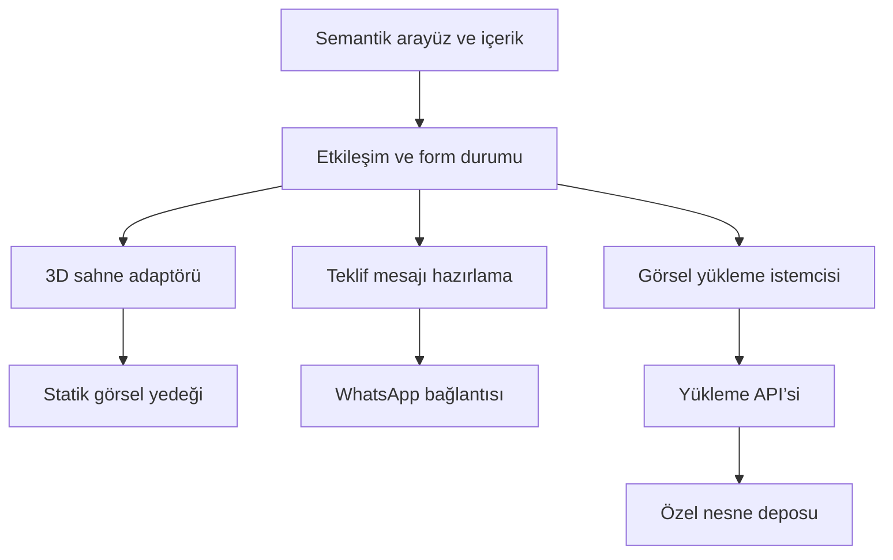

# ZY Reklam — Mimari

**Sürüm:** 1.27 · **Tarih:** 2026-10-19 · **Durum:** P3 fiziksel cihaz performans kabulü açık; P7 admin medya/taslak akışı yerel entegrasyonla doğrulandı, KV/R2 provision edildi; production secrets ve canlı GitHub yayını engelli; responsive viewport alt kabulü ve 2K+ ziyaretçi site genişlik ayarı doğrulandı

**İlgili belgeler:** [Yol haritası](ROADMAP.md) · [Çalışma kuralları](AGENTS.md)

## 1. Amaç ve mevcut durum

ZY Reklam web sitesi bir **dijital üretim atölyesi** olarak tasarlanacaktır. Ziyaretçi üretim kabiliyetini görür, gerçek işleri inceler, kendi tabela fikrini dener ve anlaşılır bir teklif talebi oluşturur.

GitHub deposu `akinarslan/zy_reklam`, 1 Ekim 2026 tarihinde boş olarak doğrulanmıştır. Bu belge hedef mimariyi ve doğrulanmış uygulama durumunu ayrı tutar. P2 temeli ve P3 açılış sahnesi uygulanmıştır; P3 performans kapanışı ile P4–P9 özellikleri hedeftir. Mevcut kod, iletişim ve varlıklar incelendi; canlı yayın erişimi henüz doğrulanmadı. Kullanıcının aynı gün belirlediği logo PNG’si `public/assets/brand/zy-reklam-reference.png` yoluna alınmıştır. Mevcut kaynaklar `akinarslan/adex-reklam-demo` deposunun `497677a411e8e229333152b7474a1d5f34eb6152` commit’inden `legacy/` altına değişmeden alındı. Yatay vektör logo ve Citadel WOFF dosyası public alana taşındı; önceki logo PDF’si okunup vektör içerdiği doğrulandı. Detaylar `docs/BASELINE.md` ve `docs/ASSET_INVENTORY.md` içindedir.

Temel yolculuk: **İşi anla → Gerçek projeleri gör → Tabela fikrini dene → Teklif talebini hazırla → WhatsApp’ta gönder.**

## 2. Ürün kapsamı ve sayfa düzeni

| Sıra | Bölüm | Ziyaretçi deneyimi | İş amacı |
| --- | --- | --- | --- |
| 1 | Başlık ve gezinme | ZY kimliği; hizmet, proje, stüdyo ve iletişim bağlantıları | Hızlı yön bulma |
| 2 | 3D açılış | Özgün ZY amblemi ışıklı pleksi ve metal tabela görünümünde; sınırlı hover ve sürüklemeyle tam yatay dönüş | Üretim kalitesini hissettirme |
| 3 | Üretim anlatımı | Metal kasa, LED, pleksi ve ön yüz kaydırmayla ayrılıp birleşir | Yapılan işi açıklama |
| 4 | Hizmetler | Doğrulanmış tabela/montaj, dijital baskı, lazer kesim ve promosyon; CNC/UV doğrulanmadı | Talebi doğru işe yönlendirme |
| 5 | Gerçek projeler | Büyük fotoğraflar, tür filtreleri, mevcutsa önce/sonra | Güven ve kanıt |
| 6 | Mini Tasarım Stüdyosu | İşletme adı, font, zemin, renk ve ışıklı/ışıksız seçenekleriyle önizleme | Somut bir müşteri fikri oluşturma |
| 7 | Teklif al | İş türü, yaklaşık ölçü, adet, şehir, açıklama ve isteğe bağlı görsel | Eksiksiz talep hazırlama |
| 8 | İletişim ve footer | Büyük ZY işareti; doğrulanmış iletişim; “Projenizi birlikte üretelim.” | Görüşmeyi başlatma |

Ana başlık **“Projenize özel çözümler üretiyoruz.”** Açılış eylemleri **“Projelerimizi Gör”** ve **“Teklif Al”**. Stüdyo eylemi **“Bu tasarım için teklif al”**; seçilen tasarım teklif formuna taşınır.

İlk sürüm kapsamı: bütün bölümler, bir kaliteli 3D açılış, üretim animasyonu, işlevsel tabela stüdyosu, WhatsApp metin aktarımı ve P7’de güvenli görsel yükleme bağlantısı. Stüdyo gerçek üretim teklifi veya fiyat garantisi vermez; “Temsili önizleme” açıklaması bulunur.

Promosyon gezinmesi: “Promosyonlar” altında fotoğraflı dört kart; her kart kendine ait statik kategori URL’sine gider. Kategori adları ve adresleri docs/PROMOTION_ASSETS.md içindedir. Kullanıcının 1 Ekim talimatıyla P2.7 bağımsız ön yüz işi olarak önceliklendirildi. Bu sayfalar gerçek müşteri projesi galerisi değildir.

Proje gezinmesi: Tabela, Totem, Lazer Kesim, Dijital Baskı ve Özel Üretim için beş fotoğraflı mega menü kartı ve /projeler/<kategori>/ statik sayfaları. P2.8 kullanıcı önceliğidir; yüklenen medya tasarım/uygulama örnekleri olarak etiketlenir.

İlk sürüm dışı: ödeme/sepet, otomatik fiyatlandırma, müşteri hesabı, CRM, otomatik WhatsApp gönderimi, canlı üretim takibi ve yapay zekâyla üretim görseli oluşturma. Bunlar yeni kullanıcı talimatı olmadan eklenmez.

## 3. Görsel kimlik

- Ana ortam: koyu zümrüt ve siyah; vurgu: beyaz ışık ve ölçülü altın metal.
- Kullanıcının belirlediği logo **beyaz “ZY” + altın “REKLAM”** yazısının tamamıdır; koyu zümrüt–siyah zeminde yatay bir işarettir. Kaynak: [logo referansı](public/assets/brand/zy-reklam-reference.png), 266 × 72 px PNG. Harflerin özgün kesimleri, aralıkları ve bütün logonun oranları korunur; yalnızca “ZY” kullanmak veya benzer fontla yeniden yazmak varsayılan değildir.
- 3D sahnede beyaz “ZY” ışıklı pleksi, altın “REKLAM” metal yüzey olarak görselleştirilir. Orijinal ekran görüntüsü değişmeden saklanır. Küçük raster dosya referans olarak korunur. P1.3’te kaynak SVG’nin sekiz özgün path’i görsel olarak karşılaştırıldı; `public/assets/brand/zy-reklam-wordmark.svg` statik poster ve P3 kontur kaynağıdır. Benzer fontla yeniden yazılmaz. PDF’deki ek geometrik amblem, son yatay logo referansının yerine geçirilmez.
- Citadel of Blackrose açılış başlığında kullanılır. Masaüstü başlangıç ölçüsü **45 pt = 60 CSS px**; mobilde taşmayı önleyen ölçek kullanılır. Gövde ve form metinlerinde okunaklı bir font seçilir.
- Citadel glifleri denetlendi: sabit başlığın bütün harfleri vardır; genel Türkçe sette `Ğ ğ İ Ş ş` eksiktir. Başlık Citadel olarak korunur; diğer içerik, menü ve form alanları Türkçe destekli Arial/Helvetica/sistem sans-serif kullanır. Arşiv kullanım metnindeki tek proje ödeme koşulu envanterde korunmuştur; belge satın alma kanıtı değildir.
- Footer koyu zümrüt; `@yakinyazilim` beyaz ve hizalı tutulur. Bağlantının gerçek hedefi envanterden alınır.
- Sekme ikonu gönderilen özgün logo ile oluşturulur; ikonun zemini siyah olur. Logo içeriğine gereksiz siyah dolgu uygulanmaz.
- Gerçek proje görselleri baskın olur. Uydurma müşteri, referans, başarı sayısı veya proje bilgisi kullanılmaz.
- Sahne üzerine konan içerik yeterli kontrastla okunur; beyaz/altın ışıklar metni bastırmaz.

## 4. Teknik yaklaşım

### 4.1 Başlangıç kararı

Önerilen yeni ön yüz: **Vite + TypeScript + semantik HTML/CSS + Three.js**. Arayüz, içerik ve formlar normal DOM’da kalır; Three.js yalnızca ürün görselleştirmesini yönetir. CSS, `IntersectionObserver` ve kontrollü `requestAnimationFrame` ile hareket yönetilir. Ek animasyon kütüphanesi varsayılan olarak eklenmez.

P1 kararı: mevcut statik HTML/CSS/DOM yaklaşımı korunur; Vite ve TypeScript geliştirme/build ve modül sınırları için eklenir. Arayüz framework’ü eklenmez. Vite 8.3.2, TypeScript 7.0.2, Playwright 1.62.1 ve npm lockfile kurulmuştur; `npm run build` tip kontrolüyle başarılıdır. Three.js 0.186.1 P3’te görünür sahne için dinamik import ile yüklenir; hareket azaltma başlangıcında indirilmez. @types/three 0.186.0 geliştirme bağımlılığıdır. Korunan başlangıç sürümü `legacy/` içinde kalır; build çıktısı `dist/` yalnızca yeni uygulamadır.

### 4.2 Katmanlar



| Modül | Sorumluluk | Sınır |
| --- | --- | --- |
| İçerik/config | Hizmetler, projeler, iletişim, tasarım tokenları | Scene koduna ticari veri gömmez |
| Bölümler/DOM | Sayfa düzeni, erişim, CTA, form alanları | İş mantığını renderer’a bağlamaz |
| Etkileşim | Bölüm görünürlüğü, hareket tercihi, kalite modu | Tek merkezi hareket/yaşam döngüsü |
| Sahne yöneticisi | Kamera, ışık, materyal, animasyon, yükleme ve temizleme | Form veya WhatsApp yönetmez |
| Tabela stüdyosu | Doğrulanan seçim durumu ve temsili önizleme | Ana çerçeveyi değiştirmez |
| Admin paneli ve Worker | İçerik yönetimi, CSRF korumalı oturum, KV taslakları, R2 staging ve GitHub publish | Gerçek Cloudflare kaynakları ve GitHub yazma secret'ı gerektirir; production deploy doğrulaması değildir |

### A12 — Admin paneli ve Worker

Admin paneli `/admin/` altında statik Vite girişidir. Oturum parolası PBKDF2 ile doğrulanır; imzalı cookie `HttpOnly`, `Secure`, `SameSite=Strict` ve sınırlı ömürlüdür. Mutasyonlar aynı-origin ve oturuma özel CSRF token'ı gerektirir. İçerik taslağı kullanıcı başına KV'de; bekleyen medya R2 staging'de tutulur. Upload sunucuda izinli klasör, MIME, uzantı, magic byte ve 8 MB görsel / 50 MB video sınırlarıyla doğrulanır. Medya kullanım haritası, önizleme, silme koruması ve yayın önizlemesi admin akışına dahildir.

Admin yayınlaması beş içerik JSON'unu, eklenen medya bloblarını ve silinecek dosya yollarını tek bir GitHub Data API tree/commit işlemiyle `main` ref'ine uygular; commit öncesi ref yeniden okunur ve fast-forward dışı yarış 409 olarak ele alınır. Gerekli Worker değerleri `ADMIN_USERNAME`, `ADMIN_PASSWORD_HASH`, `ADMIN_SESSION_SECRET` ve yalnız yayımlama yetkisi olan ortamda `GITHUB_TOKEN`'dır. `ADMIN_DRAFTS` için gerçek KV namespace provision edilip `wrangler.jsonc`'ye bağlanmıştır; `zy-reklam-admin-media-staging` R2 bucket'ı Standard sınıfında oluşturulmuş, r2.dev public erişiminin kapalı olduğu ve bağlı custom domain bulunmadığı Wrangler ile doğrulanmıştır. Production secrets henüz tanımlı değildir. Mock GitHub ve yerel Worker testleri canlı `main` yazımı veya cloud deployment kanıtı değildir.

Worker statik yönlendirmesi GET/HEAD `/admin` isteklerini `/admin/` adresine yönlendirir ve `/admin/` isteğini `/admin/index.html` varlığına çözer. `/api/admin/*` API dispatch'i bu statik route normalleştirmesinden ayrı tutulur.

Admin medya kütüphanesi ziyaretçi teklif eki akışından ayrıdır. Aşağıdaki P7 ziyaretçi eki sözleşmesi, bu admin medya akışının yerine geçmez; ziyaretçi görselinin süreli erişimi, silme token'ı ve saklama temizliği hâlâ kendi kabulünü gerektirir. Gerçek GitHub yayın eylemi bağlı Workers Builds'i tetikleyebilir; Cloudflare deploy durumu bu panel tarafından doğrulanmaz.

| Upload istemcisi/API | Ziyaretçi teklif eki için güvenli doğrulama, süreli bağlantı ve silme | Admin içerik medyası ayrı KV/R2 staging ve GitHub publish akışıdır |

### 4.3 Önerilen dosya yapısı

Bu yerleşim hedef yapıdır; P1’de mevcut kodun düzenine göre eşlenir. Planlama dosyaları proje kökünde kalır.

```text
ARCHITECTURE.md
ROADMAP.md
AGENTS.md
LAST_REPORT.md
index.html
src/
  main.ts
  config/                 # Marka, iletişim, tema
  content/                # Doğrulanmış hizmet ve proje verileri
  sections/               # Hero, üretim, hizmetler, projeler, teklif, footer
  scene/                  # Renderer, kalite, logo, tabela, üretim katmanları
  studio/                 # Tasarım durumu, seçenekler, DOM kontrolleri
  quote/                  # Alan doğrulama, mesaj oluşturma, WhatsApp bağlantısı
  upload/                 # API istemcisi, yerel önizleme, yükleme durumu
  motion/                 # Hareket tercihi ve yaşam döngüsü
  styles/                 # Tokenlar, düzen, bileşen stilleri
public/
  assets/brand/
  assets/fonts/
  assets/projects/
  assets/models/
server/                   # P7’de seçilen yükleme sağlayıcısına uygun kod
tests/                    # Davranış ve kritik akış testleri
docs/
  ASSET_INVENTORY.md       # P1 kaynak, lisans ve kullanım envanteri
  BASELINE.md              # P1 mevcut site/SEO/yayın bilgisi
  decisions/              # Sonraki önemli kararların gerekçeleri
  evidence/               # Aşama kabul kanıtları; müşteri verisi içermez
```

Build çıktısı, bağımlılık klasörleri, sırlar ve yüklenen müşteri görselleri sürüm kontrolü dışında tutulur. `public` içindeki varlıklar paketlenmeden sunulabileceğinden toplam yük ayrıca ölçülür.

## 5. 3D ve hareket mimarisi

### Açılış sahnesi

- Özgün amblemden türetilen ışıklı pleksi ve altın metal katmanlar; kontrollü çevre ışığı ve yumuşak gölge.
- Normal hover yatay ±18°, dikey ±10°; açık sürüklemede yatay açı sınırsızdır. Bırakmada en yakın ön/arka yüze kısa snap; sol/sağ ok180° geçişi. Yazı ve gezinme DOM’da sabit kalır.
- Mobilde açık bir dokunma/sürükleme alanı; sayfanın dikey kaydırması engellenmez. Sensör izni veya cihaz eğimi gerekmez.
- Arka plan çizgileri düşük maliyetli CSS veya sahne unsurlarıdır; tüm sayfada parçacık efekti kullanılmaz.
- Statik poster ilk ekrandadır. 3D modülü sonradan yüklenir; yükleme başarısızsa poster ve CTA’lar kullanılmaya devam eder.

### Üretim anlatımı

Metal kasa → LED → pleksi → ön yüz → tamamlanmış tabela, örnek bir üretim akışı olarak etiketlenir. Her tabela türünün aynı katmana sahip olduğu iddia edilmez. Bölümün kaydırma ilerlemesi katmanların konumuna bağlanır; metin her aşamayı açıklar.

Tek merkezi sahne yöneticisi aktif sahneyi açılış/üretim/stüdyo arasında yönetir. Aynı anda yalnızca **bir aktif WebGL renderer** hedeflenir; görünmeyen sahneler durur. Başka bölümde kullanılan ürün gösterimleri poster veya hafif DOM animasyonu kullanabilir. Sabit canvas konumu CTA’ların üstüne gelmez ve pointer olaylarını yalnızca gereken yerde alır.

Lazer: amblemi açığa çıkaran sınırlı maske/ışık animasyonu. Baskı: tasarımın yüzeye yerleşmesi. Bunlar ana 3D sahne bütçesini aşmadan uygulanır.

### Yaşam döngüsü ve sade sürüm

- Sekme gizliyken ve sahne görünmüyorken render döngüsü durur.
- `prefers-reduced-motion` veya kullanıcının “Hareketi azalt” seçimi, sürekli dönüşü ve scroll hareketini kapatır; bölüm açıklamaları kalır.
- Düşük kare hızında efektler azaltılır; toparlanmazsa statik önizlemeye geçilir. WebGL yokluğu ve context kaybı aynı güvenli yolu kullanır.
- Renderer değişiminde texture, geometry, material, observer ve event listener’lar temizlenir.
- Stüdyo seçimleri renderer’dan bağımsız tutulur; sahne yeniden kurulsa da kullanıcının metni ve seçenekleri korunur.

## 6. İçerik ve durum sözleşmeleri

### İçerik

`Service`: `id`, `title`, `description`, `image`, `quoteType`.

`Project`: `id`, `title`, `serviceIds`, `cover`, `gallery`, `alt`, isteğe bağlı `location`, `beforeImage`, `afterImage`. Gerçek önce/sonra çifti yoksa karşılaştırma kontrolü gösterilmez. Boş kategoriler uydurma projelerle doldurulmaz.

`BrandConfig`: doğrulanmış isim, logo yolları, slogan, telefon, WhatsApp numarası, adres, sosyal bağlantılar ve SEO verileri. Numara uluslararası rakam biçiminde tutulur; bilinmeyen numara ile etkin teklif bağlantısı yayınlanmaz.

### Tabela tasarımı

`SignDesign` alanları: `version`, `businessName`, `fontId`, `backgroundId`, `letterColor`, `lighting` (`lit` / `unlit`), isteğe bağlı `widthCm`, `heightCm`.

Varsayılan kısıtlar: işletme adı 1–60 karakter; seçenekler izinli listelerden; renk doğrulanmış HEX. Tabela yazısı önce text node/canvas çizimiyle güvenli biçimde işlenir. Müşteri girdisi `innerHTML` veya script olarak kullanılmaz. Türkçe karakterler ve uzun isimler önizlemede sınanır. Font seçenekleri yalnızca desteklenen ve kullanımı uygun dosyalardan gelir.

Gerçek ekstrüzyon için onaylı font konturları kullanılır. Kontur bulunmayan fontlarda texture düzlemiyle görselleştirme yapılır ve kabartma derinliği gerçekte varmış gibi sunulmaz. Metnin ekran dışına taşması otomatik ölçek/satır kararıyla engellenir.

### Teklif

`QuoteDraft` alanları: `serviceId`, ölçü birimi açık `widthCm`/`heightCm`, `quantity`, `city`, `notes`, isteğe bağlı `design`, `attachmentRef`. Zorunlu alanlar hizmete göre belirlenir; ölçüler yaklaşık olarak etiketlenir. Bilinmeyen ölçü için “Ölçüyü bilmiyorum” seçimi bulunur; uydurma değer girilmez.

Adet pozitif tam sayıdır; girilen ölçü pozitif sonlu sayıdır; boş açıklama mümkündür. Ondalık virgül normalize edilir. Not başlangıç sınırı 500 karakterdir. Hizmet, tasarım ve yükleme verileri ayrı tutulur; sayfa yenilemede müşteri bilgisi varsayılan olarak kalıcı depolanmaz.

Stüdyodan form açıldığında tasarımın mevcut durumu aktarılır. Formun “Tasarımı düzenle” işlemi stüdyoya geri döner ve önceki seçimleri korur. Kaydetme veya sayfalar arası paylaşım sonradan eklenirse veri sürümü ve süre sınırı ayrıca karara bağlanır.

## 7. WhatsApp ve görsel akışı

1. Form istemci tarafında doğrulanır.
2. Seçimlerin okunabilir bir özeti ve varsa süreli görsel bağlantısı oluşturulur.
3. Kullanıcı “WhatsApp’ta teklif iste” butonuna basar.
4. Doğrulanmış numarayla `https://wa.me/<numara>?text=<kodlanmış-metin>` bağlantısı açılır; metin uygun şekilde URL kodlanır.
5. Kullanıcı WhatsApp’ta mesajı inceler ve gönderir. Sitede “Talebiniz gönderildi” bildirimi gösterilmez; bağlantı açılması teslimat kanıtı değildir.

WhatsApp linki dosya eklemez. P6’daki yerel dosya seçimi yalnızca önizleme sağlayabilir; bu aşamada “Görseli WhatsApp’ta ayrıca ekleyin” açıklaması gerekir. **Tam görsel yükleme özelliği P7’de** API ve özel nesne deposu ile tamamlanır. P6 geçici sürümü tam özellikli yayın olarak sunulmaz.

### P7 yükleme API sözleşmesi

Bu sözleşme ziyaretçinin teklif formuna eklediği dosyalar içindir; admin panelinin public site medyalarını yönetmesiyle aynı akış değildir.

- Küçük, ön yüzden ayrı bir sunucu/işlev; özel nesne deposu. Sağlayıcı mevcut hosting, maliyet ve veri politikası P1’de incelendikten sonra karar kaydına yazılır. Ön yüzde hiçbir depo anahtarı bulunmaz.
- `POST /api/attachments`: JPEG/PNG/WebP dosyası; başlangıç sınırı 5 MB ve tek görsel. Başarılı yanıtta rastgele `attachmentId`, kısıtlı `viewUrl`, `expiresAt` bulunur.
- Sunucuda dosya boyutu, gerçek tür/decode ve piksel sınırı denetlenir; dosya güvenli raster biçimde yeniden kodlanır, konum/EXIF verileri kaldırılır. SVG/HTML/PDF bu uçta kabul edilmez.
- `viewUrl` kısa ömürlü ve tahmin edilemez erişim anahtarlı görüntüleme bağlantısıdır; depo listelemesi açık değildir. “Bağlantıya sahip olan görebilir” ve son kullanım zamanı yüklemeden önce kullanıcıya açıklanır.
- `DELETE /api/attachments/<id>`: yalnızca yükleme sahibine verilen ayrı silme tokenı ile çalışır. Mesaja silme tokenı eklenmez. Belirlenen süre dolunca dosya gerçekten temizlenir; süresi dolmuş link veri döndürmez.
- Başlangıç saklama önerisi 7 gündür; iş ihtiyacı ve kullanıcıya gösterilecek veri metni P7’de kesinleştirilir. Hukuki uygunluk tamamlanmış sayılmaz; metin işletmenin gerçek uygulamasına göre hazırlanır.
- CORS izinli site adresleriyle sınırlıdır; CORS tek başına kötüye kullanımı önlemez. Sunucuda hız sınırı, toplam kota ve gerekirse bot kontrolü bulunur.
- Kullanıcı hatasında anlaşılır mesaj; sunucu/limit hatasında tekrar deneme veya WhatsApp’ta elle ekleme yolu sunulur. Yükleme başarısızlığı girilen teklifi silmez.
- İstemci seçilen görseli açık kullanıcı eylemiyle yükler. Gizli yükleme, müşteri içeriği analytics kaydı ve sonsuz saklama yoktur.

WhatsApp uygulamasının açılmadığı durumda aynı teklif metni kopyalanabilir; doğrulanmış telefon/alternatif iletişim görünür. Mesaj boyutu P6’da uzun gerçek girişlerle denetlenir ve form sınırları buna göre ayarlanır.

## 8. Performans ve erişilebilirlik

Bu sayılar henüz ölçülmüş sonuçlar değildir; P2/P8 kabul hedefleridir. Sabit mobil test profili, sayfa URL’si, koşul ve ham rapor kanıt olarak kaydedilir.

| Ölçüt | Başlangıç hedefi / yöntem |
| --- | --- |
| İlk içerik | Başlık, poster ve CTA 3D yüklenmesini beklemez |
| Core Web Vitals | Temsili mobil ölçümde LCP ≤ 2,5 sn, CLS ≤ 0,1; sahada yeterli veri oluşunca INP ≤ 200 ms hedefi; laboratuvar etkileşim ölçümü saha INP’si diye sunulmaz |
| Lighthouse | Belirlenen mobil profilde performans ≥ 85, erişilebilirlik ≥ 95; üç koşunun ortanca sonucu |
| Başlangıç transferi | 3D ertelenmiş paket ve alt bölüm görselleri hariç sıkıştırılmış ilk yük toplamı ≤ 1 MB |
| Açılış 3D varlıkları | Texture/model/env toplam transferi ≤ 3 MB; paket maliyeti ayrıca raporlanır |
| Kare hızı | Tanımlı masaüstünde yaklaşık 60, tanımlı orta seviye mobilde ≥ 30 FPS; düşük cihazda sade sürüm |
| Görseller | Uygun boyutlar, responsive kaynaklar, alt bölümlerde lazy load, belirli en/boy |
| Font | Yerel dosya, uygun format, gerekli set, `font-display`; lisansa uygun dönüşüm |
| Erişim | Klavyeyle tüm kontroller; görünür odak; form label/hata ilişkilendirmesi; renk dışında durum göstergesi |

Canvas dekoratif olduğunda erişim ağacından çıkarılır; gerekli ürün bilgisi DOM metninde sunulur. Stüdyo seçimleri canvas dışındaki kontrollerden yapılır. Animasyon azaltma tercihi ilk açılışta uygulanır. Mobilde yatay taşma olmamalıdır.

## 9. SEO, güvenlik ve yayınlama

- İlk HTML’de anlamlı ana başlık, hizmet özeti, metadata ve iletişim bulunur; yalnızca canvas’tan oluşan sayfa yoktur. JS olmadan temel içerik ve iletişim erişilebilir kalır.
- Mevcut URL, title, description, canonical, favicon, robots ve sitemap durumu P1’de çıkarılır. Kaldırılan adresler varsa yönlendirme haritası hazırlanır.
- `zyreklamdijital.com.tr` ve `www` davranışı mevcut kurulumda doğrulanır; canonical tek hedefe göre ayarlanır. Hosting/DNS sağlayıcısı veya çalışan kayıtlar bu iş kapsamında değiştirilmez.
- Yerel işletme yapılandırılmış verisi sadece gerçek ve doğrulanmış bilgilerle oluşturulur; gizli veya uydurma adres kullanılmaz.
- HTML enjeksiyonu engellenir; dış bağlantılar güvenli açılır. Upload API dışında gerekli olmayan backend eklenmez. Sırlar yalnızca sunucu ortamındadır.
- Analytics ilk sürüm için zorunlu değildir. Eklenecekse kişisel form içeriği, tasarım metni ve görsel linkleri olay verisine yazılmaz; izin ve veri metni gerçek uygulamaya göre ele alınır.
- Mevcut hostingle uyumlu build çıktısı kullanılır. Yeni sitede upload API ayrı dağıtılabilir. P9 yayın kararı gerçek sağlayıcı ve yetki durumuna göre uygulanır.
- Canlıya geçmeden önce mevcut sürümün geri dönüş paketi/commit’i, yayın kontrol listesi ve domain kontrolleri hazır olur. Sonrasında uçtan uca kısa kontrol yapılır.

## 10. Doğrulama stratejisi

Bir birim testin değeri somut davranıştır: Türkçe/özel karakterlerle mesaj kodlama, ölçü/adet doğrulama, stüdyo durumunun forma aktarılması, yükleme hata durumunda verinin korunması ve upload API sınırları.

Tarayıcı kontrolleri: temel gezinme; filtre; klavyeyle stüdyo ve form; masaüstü/mobil; hareket azaltma; WebGL kapalı/context kaybı; bağlantı kopyalama; upload başarılı/hatalı/süresi dolmuş durumları. WhatsApp metni testte hazırlanabilir; test otomatik olarak gerçek kişiye mesaj göndermez.

Görsel kanıtlar: açılış, üretim, galeri, stüdyo, form ve footer için seçili ekran boyutları. Performans çıktıları P8’de kayıt altına alınır. Test/CI altyapısı P2’de kurulur; mevcut olmayan testler çalışmış gibi raporlanmaz.

## 11. Karar kaydı

| ID | Karar | Durum | Gerekçe / sonraki kontrol |
| --- | --- | --- | --- |
| A01 | Dijital üretim atölyesi; zümrüt/siyah, beyaz/altın | Kabul | Kullanıcının istediği tasarım yönü |
| A02 | Bir kaliteli açılış sahnesi; sınırlı ek animasyon | Uygulandı; performans kabulü açık | 19 test geçti; ölçüm aracı hazır; fiziksel GPU ölçümleri henüz yok |
| A03 | DOM içerik/forma öncelik; 3D bağımsız ve yedekli | Uygulandı ve test edildi | WebGL/context/yükleme hataları ve hareket tercihi kontrolleri geçti |
| A04 | Mevcut DOM korunur; Vite/TypeScript modüler build, Three.js P3 | Kabul; temel build doğrulandı | Statik başlangıç arşivlendi; framework eklenmedi, sürümler/lockfile sabitlendi |
| A05 | Tam yatay SVG logo; Citadel başlık 45 pt; gövde sistem fontu | Kabul; kaynak/glif incelemesi yapıldı | Orijinal SVG/PDF konturları mevcut; sabit başlık destekleniyor, diğer metinlerde Türkçe eksikleri önleniyor |
| A06 | WhatsApp metin talebi; otomatik gönderim/fiyat yok | Kabul | İlk sürümün satış akışı |
| A07 | Gerçek görsel yükleme için ayrı API/özel depo | Tasarım kabul; sağlayıcı bekliyor | Link ile dosya eklemenin farkı; P7 tamamlama |
| A08 | Mevcut domain/hosting korunarak entegrasyon | P1 doğrulaması bekliyor | Çalışan yayının gereksiz değişmemesi |
| A09 | Her talimatta mimari ve roadmap kontrolü | Kabul | Kullanıcının plan takibi isteği; AGENTS.md ile kalıcı kural |
| A10 | Promosyonlar altında dört fotoğraflı kategori ve ayrı statik sayfa | Kullanıcı talimatıyla uygulandı | P2.7; 3D’den bağımsız gezinme ve katalog içeriği |
| A11 | Projeler altında beş örnek kategori; kontrollü video | Kullanıcı talimatıyla uygulandı | P2.8, müşteri projesi sahipliği varsayılmaz |
| A12 | Admin paneli Cloudflare Worker ile backend'e bağlandı | Login/session ve local Worker dry-run; A16 KV/R2 kodu/testleri eklendi | Gerçek kaynak provisioning, GitHub `main` yazımı ve Cloudflare deploy doğrulaması açık |
| A16 | Admin medya kütüphanesi ve kalıcı taslak | Kod + yerel Worker entegrasyonu doğrulandı; Cloudflare provisioning/live publish açık | KV taslak, R2 staging, CSRF, içerik kullanım koruması ve tek GitHub commit'i; visitor attachment sözleşmesinden ayrıdır |
| A17 | Ana site ve admin için bağımsız responsive ölçekleme | Kod ve Chromium viewport emülasyonu ile doğrulandı; P8 genel kabulü açık | Admin içerik 1760px / header-nav 1824px; admin editör alanı en çok 1200px. Ziyaretçi sitesi 1920–2559px aralığında 1880px, 2560–3439px aralığında 2240px, 3440px+ aralığında 2560px shell üst sınırı kullanır. DPR mevcut 1,5 sınırında kalır |
| A18 | Admin statik route ve production binding yapılandırması | Yerel route/asset testleri, build ve Wrangler dry-run geçti; KV/R2 kaynakları doğrulandı; Workers preview build başarısız, production secrets eksik | `/admin` → `/admin/` → `admin/index.html`; KV ID eşleşiyor, R2 private. Secrets ve başarısız Cloudflare Build logu bekliyor |
| A19 | 2K ve ultrawide ziyaretçi sitesi ölçeklemesi | 1920/2560/3440/3840 Chromium ölçümleri ve screenshot incelemesi geçti | Yalnızca ziyaretçi `src/styles/` alanı; 2560px+ hero 800–880px, başlık 90–100px, tabela sahnesi 600–680px. Admin CSS ve responsive davranışı değişmez |

Mimari değişiklikte sürüm, tarih, ilgili karar ve etkilenen roadmap işi güncellenir. Yeni kullanıcı talimatıyla değişen kapsam eski kabul ölçütlerine gizlenmez.

### 2026-10-15 — A12 admin Worker kapsamı ve doğrulama sınırı

Admin paneli Cloudflare Worker'a bağlandı; yerel login/session/content PUT akışı, üretim build'i ve Wrangler dry-run doğrulandı. GitHub `main` üzerinde gerçek commit, Cloudflare deploy, gerçek secret'lar, kalıcı taslak depolama ve medya uploader/depo bu teslimde doğrulanmadı veya tamamlanmadı. P7 açık kalır. Statik kategori HTML'leri ve `public/sitemap.xml`, `npm run generate:pages` tarafından içerik JSON'u ve generator'lardan yeniden üretilen çıktılardır; değişiklikleri build öncesinde tekrar üretildiği için admin kaynak commit'ine dahil edilmez.

### 2026-10-16 — A16 Admin medya kütüphanesi ve kalıcı taslak

Admin içerik ve medya taslakları Worker tarafında KV/R2 ile kalıcılaştırılır; panel localStorage'a bağımlı değildir. CSRF + aynı-origin denetimi, imza/MIME/uzantı/klasör/boyut doğrulaması, izinli medya hedefleri, upload ilerlemesi ve önizleme, kullanım haritası, kullanımdayken silme engeli, değişiklik önizlemesi ve yayın geçmişi eklendi. GitHub Data API'de JSON, binary medya ve silme yolları tek tree/commit içinde toplanır; `main` ref'i commit öncesi tekrar kontrol edilir. GitHub istekleri mock ile, Worker ise ayrı geçici local KV/R2 durumuyla test edilir.

Cloudflare KV namespace ID'si config'te bilinçli olarak yer tutucudur; staging R2 bucket ve secret'lar gerçek hesapta oluşturulmadı. Gerçek GitHub `main` commit'i veya Cloudflare production deploy çalıştırılmadı. Admin medya yönetimi ziyaretçi teklif eki linki değildir; ziyaretçi eki P7.1–P7.6 kabulü açık kalır. A16, mevcut mimariyi admin medya işine genişletir ve P7 genel aşamasını tamamlandı yapmaz.

### 2026-10-16 — A17 ana site ve admin responsive ölçekleme

Ana site ve `/admin/` responsive stilleri kendi CSS sınırlarında tutuldu. 1440px üstünde ana container 1760px, admin içerik 1760px ve admin header/nav 1824px ile sınırlıdır; admin uzun alanları 1200px'i aşmaz. Hero, hizmet detayları, showcase, showroom, proje videosu ve promosyon ürün boyutları geniş ekranlarda kontrollü `clamp()` değerleriyle büyür. Admin medya kartları en çok altı kolonda kalır; tablet/hamburger eşiği 1100px, dokunma hedefleri en az 44px'tir. Three.js renderer DPR mevcut 1,5 sınırını korur; bu işte renderer kodu değiştirilmedi.

Playwright Chromium viewport emülasyonunda 15 ölçüde ana site ve admin sayfa taşması kontrol edildi; üretilen 14 hizmet/proje/promosyon kategorisi beş seçili genişlikte ayrıca açıldı. İstenen beş masaüstü çözünürlük ekran görüntüleri `docs/evidence/responsive/` altında üretildi ve görsel olarak incelendi. Bu laboratuvar/emülasyon kanıtı fiziksel cihaz, gerçek GPU, saha performansı veya tam P8 kabulü değildir. Veri sözleşmesi ve yayın mimarisi değişmedi.

### 2026-10-16 — A18 Cloudflare admin route ve kaynak yapılandırması

`ADMIN_DRAFTS` için Cloudflare'da gerçek namespace oluşturuldu ve ID `wrangler.jsonc` ile eşleşiyor. `zy-reklam-admin-media-staging` R2 bucket'ı oluşturuldu; Wrangler bilgisi Standard storage class gösteriyor, `r2.dev` public erişimi kapalı ve custom domain bağlı değil. Worker GET/HEAD `/admin` isteğini `/admin/`'ye yönlendirir; `/admin/` doğrudan `/admin/index.html` statik varlığına gider. `/api/admin/*` dispatch değişmeden kaldı. Yerel entegrasyon testi admin HTML, JavaScript/CSS varlıkları, `/admin`, `/admin/` ve `/admin/index.html` yollarını doğrular.

TypeScript kontrolü, production build, 42/42 seri test ve Wrangler dry-run geçti; build çıktısında `dist/admin/index.html` ve hash'li JS/CSS var. Dry-run yalnızca config'i derler; production secrets veya canlı deploy doğrulaması değildir. `wrangler secret list` boş döndü. PR #2 head SHA'sındaki GitHub Verify başarılı (run `38897936832`), ancak Cloudflare Workers Builds preview check'i başarısız (build `4bcd17f8-cd9a-47d3-b4a9-0162acee435c`); Cloudflare dashboard session'ı authenticated olmadığından log içeriği alınamadı. Bu nedenle PR draft/merge kapısı ve canlı deployment `/admin/` kontrolü açık kalır; gerçek GitHub publish, manuel deploy veya `main` değişikliği yapılmadı.

### 2026-10-17 — A19 2K ve ultrawide ziyaretçi sitesi ölçeklemesi

Ziyaretçi sitesi shell'i 1920px'te 1800px, 2560px'te 2240px, 3440px ve 3840px'te 2560px ölçüldü. 2560px+ hero 800–880px, tabela sahnesi 600–680px, başlık 90–100px aralığında kontrollü ölçeklenir; hizmet kartları, workshop/promosyon/iletişim kolonları, proje daveti, showroom ve showcase de geniş shell'i kullanırken metin blokları sınırlı kalır. Bu yalnızca CSS sunum kararıdır: admin stilleri, veri sözleşmeleri, Worker, route ve yayın mimarisi değişmedi.

Playwright Chromium testinde 15 ana-site viewport'u ile 14 üretilmiş ziyaretçi sayfası kontrol edildi; 390, 768, 1366, 1440 ve 1920 regresyon ölçüleri yatay taşmasız geçti. 1920×1080, 2560×1440, 3440×1440 ve 3840×2160 ana sayfa görüntüleri üretildi ve incelendi; navbar, 2K hero/tabela boyutu ve dengeli shell boşlukları doğrulandı. Test/emülasyon gerçek fiziksel ekran veya GPU performans ölçümü değildir.

### 2026-10-01 — v1.1 logo kaynak açıklaması

“logo bu” talimatıyla tam yatay yazı logosu referans olarak alındı. Beyaz/altın materyal eşlemesi netleştirildi. Etkilenen işler P1.2, P1.3 ve P3.1–P3.2. Aşama sırası ve ürün kapsamı değişmedi; 3D veya vektör henüz üretilmedi.

### 2026-10-01 — v1.2 kaynak ve ön yüz kararı

32 dosyalık başlangıç snapshot’ı, vektör logo, font ve iletişim envanteri alındı. P2 için mevcut DOM mantığı korunarak Vite/TypeScript kabul edildi. Gerçek proje fotoğrafları doğrulanmadığı için P1.5/P5 açık kalır; bu eksik bağımsız temel layout hazırlığını engellemez. CNC/UV mevcut içerikte doğrulanmadı ve hizmet listesine eklenmedi. Hosting yayın erişimi P9’da, upload sağlayıcısı P7’de kesinleşecek. P2’deki mevcut ad/mesaj formu eski iletişim davranışını korur; P6’daki ölçü/adet/stüdyo ve P7 upload henüz uygulanmış değildir.

P2 kabul kanıtı: TypeScript/build başarılı, altı gerçek tarayıcı testi başarılı; 360/768/1440 px taşma ve JS kapalı iletişim yolu denetlendi. Ayrıntılar ROADMAP.md ve docs/evidence/P2_VERIFICATION.json içindedir. 3D/FPS/Lighthouse ve upload kabulü henüz yapılmadı.

### 2026-10-01 — v1.3 P3 sahne uygulaması

- `src/scene/hero.ts` DOM adaptörüdür; Three.js içermez. Görünürlükten 250 ms sonra renderer dinamik yüklenir. 8 saniyelik yükleme süresi, iptal/generation kontrolü ve hareket tercihinin yükleme sırasında değişmesi güvenli yedeğe döner. Gizli sekmede başlangıç yüklemesi yapılmaz.
- `src/scene/logo.ts` onaylı SVG’nin sekiz path’ini `SVGLoader.parse` ve `ShapePath.toShapes` ile gerçek ekstrüzyona çevirir; R/A içindeki iki boşluk korunur. ViewBox merkezi/ölçeği kaynakta korunur; benzer font kullanılmaz. Beyaz ZY kasa/LED/pleksi katmanlıdır; altın REKLAM metal yüzeydir.
- `src/scene/renderer.ts` bir renderer kullanır. RoomEnvironment/PMREM çevresi cihazda üretilir; harici HDR, texture ve GLB indirilmez. 512 px gölge haritası; DPR masaüstü 1,5, dar ekranda 1,25 ile sınırlı; düşük kalitede DPR 1 ve gölge kapalıdır.
- Dönüş yatay ±18°, dikey ±10° ile sınırlandırılır. Dokunma alanında `touch-action: pan-y` dikey scroll’u korur. Dokunma sonrası seçilen dönüş korunur; fare çıkışında başlangıç açısına döner. Otomatik sürekli salınım eklenmedi.
- Dönüş yerleşince RAF döngüsü durur; görünmeyen sahne ve gizli sekme durur. Context kaybında poster açılır ve renderer/geometri/materyal/env/gölge/listener/observer kaynakları temizlenir. BFCache geçişleri modeli yok etmeden durdurur; gerçek çıkışta temizler.
- İki ardışık 2 saniyelik pencerede 24 FPS altındaki etkileşim kaliteyi azaltır; aynı durum düşük kalitede sürerse poster seçilir. Bu politikanın 10 FPS örneklemesi simülasyonla denetlendi; fiziksel yavaş cihaz testi yerine sayılmaz.
- 15 yerel test geçti; P3 testleri derlenmiş `dist/` preview üzerinde çalıştı. Yazılımsal ANGLE/SwiftShader: masaüstü 1440 px/DPR1/CPU1 ~37,3 FPS; mobil görünüm 360 px/DPR2/CPU4 ~51,4 FPS. Ölçüm 4,5 saniyelik etkileşim örneğidir; gerçek masaüstü/orta seviye telefon GPU kabulü değildir. Masaüstü yazılımsal örnek 60 FPS hedefinin altında olduğundan hedef karşılandı iddiası yok.
- Kaynak SVG 8.340 bayt; dış model/texture/env transferi sıfır; ertelenen JS 604.835 bayt ham / 154.582 bayt Node gzip ölçümü. Vite’ın 500 KB chunk uyarısı görünür biçimde kaydedildi; ilk JS’ye birleştirilmedi ve uyarı eşiği yükseltilmedi. Kabul kanıtları docs/evidence/P3_VERIFICATION.json ve P3_BUDGET.json içindedir.

P3.1–P3.5 işlevleri doğrulandı; P3 aşama kabulü fiziksel cihaz performans ölçümü/optimizasyonu nedeniyle devam ediyor. P4 henüz başlatılmadı; sahne yöneticisinin sonraki üretim/stüdyo geçişleri bu aşamada uygulanmış sayılmaz.

### 2026-10-01 — v1.4 gölge çizim bütçesi (P3.6)

Hareket sırasında 512 px gölge haritası en fazla 20 Hz güncellenir; aradaki kareler mevcut haritayı kullanır. Dönüş yerleşen son karede değişen poz mutlaka gölgeye aktarılır; idle ve kamera boyutu değişiminde aynı poz için gereksiz gölge çizilmez. Görünür ana sahnenin RAF hızı sınırlandırılmadı; logo konturları, materyaller ve DPR sınırları korundu. A02/A03 ve aşama sırası değişmedi.

16 yerel test geçti. Yeni production WebGL kontrolü hareket sırasında çizim sınırını, son poz/gölge eşleşmesini ve idle gölge durmasını doğrular. Üç eşleşmiş önce/sonra örneğinin ortanca FPS değerleri: masaüstü yazılımsal 36,6 → 38,2; CPU4 mobil emülasyon 51,2 → 52,3. Dağılımlar örtüşmektedir; kalıcı cihaz hızlanması veya yaklaşık 60 FPS kabulü iddia edilmez. Ham kayıt: docs/evidence/P3_PERFORMANCE_COMPARISON.json. Önceki v1.3 sayıları ilk teslimin tarihsel ölçümleridir; güncel paket boyutları P3_BUDGET.json içindedir. Fiziksel cihaz kabulü ve P3.6 açık; P4 başlamadı.

### 2026-10-01 — v1.5 fiziksel cihaz ölçüm aracı (P3.6)

`public/qa/scene-performance.html`, performance.js/sampler.js ve CSS bağımsız operatör aracıdır. Ana menü/sitemap dışında ve noindex/nofollow olarak sunulur. Ana sayfa bu kodu yüklemez; build'in ana JS/renderer paketleri değişmedi. Araç, kullanıcının başlatmasıyla aynı origin üretim sayfasını tam viewport iframe'inde açar; ikinci sahne veya renderer yaratmaz.

Üç aktif örnek, örnek başına 1 saniye atılan ısınma, render çağrısı sayaçları, bir saniyelik FPS pencereleri ve kalite geçişleri kaydedilir. Varsayılan örnek 10 saniyedir; 3 saniye hızlı araç kontrolüdür. Cihaz/OS/güç bilgisi kullanıcı beyanıdır; user-agent/GPU bilgisi fiziksel ortamı otomatik doğrulamaz. Sonuç açık kullanıcı eylemiyle JSON indirilir; upload, analytics ve kalıcı tarayıcı depolaması yoktur.

Sekme gizlenmesi/resize/iptal/context veya sahne hatası sonuç geçersiz sayılır. Hareket azaltma sessizce değiştirilmez; kullanıcı ayrı düğmeyle açabilir. P3.6 fiziksel kabulü ile gerçek hareket/scroll/görsel kontrolü ayrıca incelenir; araç otomatik PASS üretmez. 19 yerel testin ve araç ekranlarının kanıtları P3_VERIFICATION.json, P3_DEVICE_TOOL_SAMPLE.json ve docs/P3_DEVICE_MEASUREMENT.md içinde kayıtlıdır. P3/P4 sırası ve FPS hedefleri korunur.

### 2026-10-01 — v1.6 ortak logo katmanları (P3.6)

Beyaz ZY’nin üç katmanı ve altın REKLAM aynı kaynak şekillerini kullanarak dört ortak mesh içinde üretilir; önceki 12 mesh’in malzemeleri ve derinlikleri değişmedi. ExtrudeGeometry tüm aynı katman şekillerini birlikte alır; çok malzemeli katmanlarda Three.js mergeGroups yalnızca aynı materyal gruplarını birleştirir. Kontur sadeleştirme yapılmadı.

Ana sahne çizim çağrısı 27 → 13 (%51,9 azalma); gölge yenilemesi başına ek çağrı 22 → 8 (%63,6 azalma). Bu ayrıştırma, gerçek WebGL2 çağrı toplamı ile render/gölge sayaçlarından hesaplandı ve 12 örneğin tamamında birebir doğrulandı.

Aynı başlangıç açısındaki masaüstü ve mobil canvas PNG’leri RGBA piksel düzeyinde önceki build ile aynıdır; görüntüler ayrıca incelendi. Özgün sekiz kontur, R/A içindeki iki boşluk, katman derinlikleri, malzemeler ve 4.882 ana sahne üçgeni korundu. Gölge yenilenen render’da sayaç 9.714 üçgen ve 21 toplam çağrı gösterebilir; bu ana sahne ile gölge işinin toplamıdır.

19/19 yerel test geçti. Masaüstü yazılımsal ortanca 38,6 → 35,5 FPS; mobil emülasyon 48,9 → 49,3 FPS. Aralıklar örtüşür; bu çalışma tutarlı FPS artışı göstermedi. Fiziksel cihaz performans kabulü açık kalır. Ertelenen renderer 606.055 bayt ham / 155.041 bayt Node gzip; önceki sürüme göre +967 ham / +337 gzip bayt. Ana JS 7.235 bayt; 500 KB Vite uyarısı sürer. Kanıtlar P3_BATCH_COMPARISON.json, P3_BATCH_VISUAL_VERIFICATION.json ve güncel P3_VERIFICATION.json içinde. A02/A03, kalite ve yaşam döngüsü ile P3/P4 teslim sırası korunur.

### 2026-10-01 — v1.7 promosyon mega menüsü ve çok sayfalı katalog (P2.7 / A10)

Kullanıcının açık yeni talimatıyla dört promosyon kategorisi, görsel mega menü ve dört ayrı sayfa eklendi. P2.7, P3 renderer’ına bağımlı değildir; P3 fiziksel cihaz kabulü ve P4–P9 teslim sırası korunur. P1.5/P5 gerçek proje fotoğrafları ayrı kabul konusudur.

İçerik kaynağı src/content/promotions.json; kategori alanları id/title/description/examples/cover/href, görsel alanları id/title/alt/category/alsoIn/section/sourceFile/sourceSHA256/variants’tır. Katalog ürünleri ortak kaynak görsellerinden türetilir; fiyat, stok, malzeme sertifikası veya sahte proje bilgisi eklenmedi. VIP ve bez ürünler aynı kategori sayfasında iki DOM bölümüdür.

scripts/generate-promotions.mjs build/dev öncesinde dört statik HTML sayfasını, ortak menüyü, ana sayfa kategori kartlarını ve sitemap’i üretir. Vite rolldownOptions.input beş HTML girişini derler. Header/footer ana sayfadan ortak üretilir; alt sayfalarda ana bölüm bağlantıları /#... biçimindedir. Başlık, meta description/canonical/Open Graph, ürün içerikleri ve iletişim linkleri ilk HTML’dedir; route fallback veya JavaScript render beklemez.

src/sections/navigation.ts native details/summary disclosure’ını fare hover, klavye ve mobil dokunma ile destekler. Escape önce alt menüyü kapatıp summary’ye, sonra mobil ana menüyü kapatıp Menü düğmesine odak verir. Dış tıklama, Tab ile çıkış ve breakpoint değişimi kapanır. Odak kontrolü native blur/focus aktarımı bittikten sonraki macrotask’te yapılır; aksi takdirde dokunma/Tab hedefi erken gizlenebilir. Listener ve zamanlayıcılar cleanup ile kaldırılır. HTML native disclosure JavaScript kapalıyken de çalışır; breadcrumb nav stilleri ana gezinmeden ayrıdır.

28 WebP türevi en çok 480/960 genişliktedir, küçük kaynaklar büyütülmez. Galeri/menü lazy load, hero eager; srcset/sizes, alt ve gerçek en/boy kullanılır. CSS contain ürünleri kesmez. Kategori sayfasında sahne hedefi yoktur; ortak ana modülün hero guard’ı 3D renderer indirmez. WhatsApp linkleri doğrulanmış numarayla ürün adı içeren metni hazırlar; mesaj kullanıcı tarafından gönderilir.

Kabul kanıtı docs/evidence/P2_PROMOTIONS_VERIFICATION.json ve docs/PROMOTION_ASSETS.md içinde kayıtlıdır. TypeScript/production build ve 23/23 yerel test geçti; dört yeni kontrol tüm kategori URL’lerini, fotoğrafları, 360/768/1440 px düzeni, klavye/dokunma/JS kapalı gezinmeyi doğruladı. Ertelenen renderer paketi değişmedi; 500 KB uyarısı ve fiziksel P3 kabulü açık kalır.

### 2026-10-01 — v1.8 projeler mega menüsü (P2.8 / A11)

JSON kaynak src/content/projects.json; 19 fotoğraf ve bir dijital totem videosu içeriklerine göre sınıflandırıldı. Kategori, görsel, video ve kaynak SHA-256 bilgileri ayrı tutulur. scripts/generate-projects.mjs önce ortak ana menüyü günceller, promosyon üreticisini çağırır ve beş proje sayfasını üretir; böylece iki koleksiyon aynı başlığı kullanır. npm run generate:pages / build on gerçek HTML girişini ve birleşik sitemap’i üretir.

Gezinme adaptörü iki disclosure’ı birlikte yönetir; birini açmak diğerini kapatır. Native summary, dokunma, hover, ArrowDown, Escape odak dönüşü ve JS kapalı kategori geçişleri korunur. Türetilmiş fotoğraflar lazy/responsive; büyük görsel ayrı bağlantıdan açılır. Video H.264/540×960, ses çıkarılmış, faststart; poster, controls/playsinline/preload=none ile açık kullanıcı eyleminde oynar. Menüde video yüklenmez.

Görseller tasarım ve uygulama örnekleridir; gerçek ZY müşteri işleri veya doğrulanmış lazer kesim tekniği iddiası yoktur. P1.5/P5 gerçek müşteri bilgisi kabulü açık, P3 fiziksel GPU kabulü ve sonraki aşamaların kapıları korunur. 26/26 yerel test geçti; üç yeni kabul iki menü etkileşimi, beş doğrudan sayfa/görsel/video/SEO ve JS kapalı koleksiyon geçişidir.

### 2026-10-01 — v1.9 proje medya genişletmesi (P2.8 / A11)

Video içerik kaydı isteğe bağlı description alanı içerir; üretici açıklamayı HTML-escape ederek gösterir. Varsayılan açıklama kategori bağımsızdır, video sayısı clips.length ile üretilir. Su ile yazı/desen oluşturan fıskiye Özel Üretim kategorisinde kullanıcı başlatmalı video olarak sunulur. Altı yeni fotoğrafla toplam 25 fotoğraf ve iki video vardır. Fotoğraf/video lazy yükleme ve tek renderer sınırı korunur.

### 2026-10-01 — A12 bağımsız 3D Vitrin (P3.7)

Kullanıcının açık kapsam revizyonu: hero ve hizmetler arasında bağımsız showroom; iki ekstrüzyon kutu harf tabela ve asimetrik totem. src/showroom modülü mevcut hero koduna dokunmadan lazy import ile yüklenir. Showroom kendi renderer/kaynaklarına sahiptir; iki canvas ayrıdır. Hero ürün alanı görünürken showroom RAF durdurulur; aynı anda iki sahnenin etkileşim döngüsü işletilmez. Bellekte iki context bulunabilmesi, özgün tek renderer hedefinin bu talimata özel açık revizyonudur.

Showroom reduced-motion durumunda 3D olarak çizilir, poz/tilt sabit kalır. Idle/offscreen/hidden döngü yok; obje bazlı proximity, dokunma ve klavye ışık tepkisi. Yükleme/WebGL/context hatasında aynı gerçek 3D kompozisyonun responsive WebP yedeği. Ürün tasarımları temsili olarak belirtilir; tamamlanmış müşteri işi iddiası yok. P3.6 fiziksel cihaz kabulü açık kalır.

### 2026-10-01 — A12 vitrin harf/ışık revizyonu (P3.7a)

Kullanıcının yeni görsel referansı özgün ZY wordmark harf stilini işaret eder. Vitrindeki ZY REKLAM, kaynak vektörün Z/Y/R/E/K/L/A/M konturlarından türetilir; diğer kelimeler aynı konturlar ile bu geometrik dile uyarlanmış D/H/I/F/G/S/T/U ve Türkçe işaretlerden oluşur. Bu showroom revizyonu önceki farklı-font şartını değiştirir; özgün hero/logo dosyalarına dokunulmaz. Her glifin gerçek ekstrüzyon krom kasası ve içe oturan ayrı ışıklı ön yüzü vardır.

İki tabelada cam göbeği, kırmızı, mavi, turuncu ve beyazın kontrollü tonları harflere dağıtılır; seçilen ürün yaklaşma/dokunma/klavye ile aydınlanır. Idle kapalı, renk döngüsü/strobe yok. Totem amber kalır. Dört yön yazısı aynı cap-height ölçeğinde, üst ZY REKLAM yaklaşık %27 daha büyük; uzun kelimeyi küçültmek yerine kutu genişliği artırılır. Bağımsız/lazy/reduced-motion/idle/offscreen/context yedeği sözleşmesi korunur.

### 2026-10-04 — A13 lightbox ve 360° araç (P3.7b)

Kullanıcının açık yeni kapsamı: mevcut tabelalara ek tabela üretmeden lightbox ve döndürülebilen kaplamalı araç. Mevcut hero ve showroom modelleri korunur; showroom ardından aynı vitrin yolculuğunda bağımsız `src/showcase` adaptörü yer alır. Bir yeni renderer iki modeli birlikte çizer; 180 px yaklaşmada dinamik yüklenir. Render yalnızca açık kullanıcı etkileşimi/resize/görünürlük olaylarında tek kare olarak planlanır; sürekli döngü, otomatik dönüş veya atalet yoktur. Bellekte ek context bulunması A12'nin bu kapsam için açık genişletmesidir; görünmez/gizli sahne çizilmez.

NOVA Coffee, bu iş için oluşturulmuş temsili marka konseptidir; ZY müşteri referansı olarak sunulmaz. Yeşil/krem/bakır kaplama ve kahve illüstrasyonu CanvasTexture ile yerelde üretilir; dış model, görsel veya font indirilmez. Araç bütün eksen çevresinde sınırsız yatay döner; pointer capture ve `touch-action:pan-y` ile dokunma/dikey kaydırma ayrılır. Klavye okları, sola/sağa ve başlangıç düğmeleri vardır. Lightbox emissive ön yüzü ayrı düğmeyle açılıp kapanır. Reduced-motion durumunda otomatik hareket yok; kullanıcı kontrollü tek kare dönüş korunur.

Context/yükleme hatasında dispose ve responsive WebP poster; bütün ticari metin DOM'da kalır. Geometri, materyal, texture, environment, gölge, observer ve listener temizlenir. P3.6 fiziksel GPU kabulü açık kalır; bu iş P4–P9 kabulü değildir.

### 2026-10-04 — A14 gerçek görseller ve Nissan modeli (P3.7c, kısmi)

Kullanıcı A13 prosedürel araç görünümünü reddetti; sağladığı lightbox ve Nissan X-Trail T32 fotoğrafları esas alınır. Lightbox özgün PNG ile DOM üzerinde gösterilir; mouse yaklaşması, klavye odağı ve ışık düğmesi belirgin parlaklık/halo sağlar. Yeni showcase controller WebGL yüklemez; önceki showroom korunur. Araç fotoğrafı yalnızca gerçek uygulama referansıdır; fotoğraf açı geçişi 360° olarak sunulmaz. Kullanıcı kesintisiz 360° seçti. Gerçek GLB/glTF modeli olmadan bu kabul karşılanmaz. Sketchfab model 30663a0fbc9e4e32b6f7adacca2b603c (Merc_TV, CC BY 4.0) bulundu; indirme API'si 401 oturum gerektirir. Model dosyası ve kaplama uygulaması beklenir. Çalışma ayrı taslak dalında tutulur, main/canlı yayın değiştirilmez.

### 2026-10-04 — A14 gerçek Nissan GLB uygulaması (P3.7c)

Kullanıcı gerçek Nissan X-Trail T32 GLB dosyasını sağladı; indirme engeli kalktı. Özgün dosya değiştirilmedi. Site türevi kullanılmayan motor/iç parçalar olmadan, sınırları koruyan meshopt sadeleştirme ve EXT_meshopt_compression ile 4.110.300 bayta düşürüldü; 232.295 kaynak üçgeni içerir. Kaynak model tek tekerlek içerdiği için dört aks konumuna örneklendi; kauçuk torus lastikler eklendi. Fotoğraftaki buyHome renk/marka kaplaması CanvasTexture ile gövdeye yeniden uyarlandı; fotoğrafla piksel düzeyinde eşleşme iddiası yok. Merc_TV, model bağlantısı ve CC BY 4.0 atfı görünür DOM'da yer alır.

Lightbox gerçek fotoğraf + DOM ışık tepkisini korur. Araç viewer ayrı dinamik src/showcase/vehicle.ts adaptörüdür: 360° görünümü aç düğmesi modeli açık kullanıcı eyleminde yükler. Bu nedenle 4,1 MB araç, ilk sayfa/hero bütçesine eklenmez. GLTFLoader + Three'ın yerel MeshoptDecoder'ı kullanılır; harici runtime model/CDN yoktur. Yükleme 25 sn süre sınırı/cleanup sinyaliyle iptal edilebilir. WebGL/context veya HTTP hatası gerçek fotoğraf ve tekrar deneme yolunu korur.

Dönüş yatayda sınırsız mouse/touch, ok tuşları, Home ve DOM düğmeleriyle yapılır; otomatik dönme/atalet yok. Dikey dokunma scroll'u korunur. Idle/offscreen/hidden render durur; resize olay başına tek kare. DPR masaüstü 1,5 / dar ekranda 1; model geometrileri, materyaller, texture/env, renderer ve listener/observer cleanup uygulanır. Hero ve önceki showroom modülleri değişmedi. Fiziksel GPU/performance kabulü P3.6 kapsamında açık kalır.

### A15 — Araç vitrini yalnızca fotoğraf (2026-10-04)

Kullanıcı A13/A14 araç 3D kapsamını iptal etti. Yeni vitrinde Nissan referans fotoğrafı mevcut kırpmasıyla sabit kalır; model, viewer, dönüş/açma/kapatma kontrolleri ve 360° metinleri kaldırılır. Lightbox DOM/CSS ışık tepkisi korunur. Hero ve önceki tabela showroom 3D kapsamı değişmez.

### A15 — Araç fotoğrafında gölge ve aydınlatma (2026-10-04)

P3.7e kullanıcı talimatı: aynı fotoğraf/crop korunur; başlangıçta mat/koyu filtre ve gölge katmanı, mouse hover veya native button dokunma/Enter/Space ile özgün parlak fotoğraf ve beyaz halo. Dokunma ikinci aktivasyonda kapanır; mouse hover geçicidir. AbortController cleanup ve reduced-motion korunur. Araç WebGL/modeli eklenmez. Mevcut DOM/CSS mimarisi içinde rutin görsel etkileşimdir.

### 2026-10-17 — A20 güvenli statik Worker Preview (P8.7a/P9)

Wrangler 4.151.0 Worker Previews için wrangler.jsonc içinde boş previews bloğu kullanılır. Bu layout PR'ında preview admin KV/R2 binding'leri kapalıdır; production ADMIN_DRAFTS ve ADMIN_MEDIA_STAGING üst seviyede değişmeden kalır. ASSETS üst seviyededir. Ayrı preview kaynakları tercih edilir; mevcut Cloudflare oturumu refresh/ağ hatası verdiği için statik preview alternatifi seçildi. Admin preview login/publish bu işin kabulü değildir. Production secret'ları kopyalanmaz, GITHUB_TOKEN eklenmez. Dashboard Previews Base kaynaklı secret varlığı authenticated metadata ile ayrıca doğrulanmalıdır; boş config tek başına uzaktaki secret yokluğu kanıtı değildir.

Preview --dry-run desteklenmediği help ile görüldü. Yalnız previews ayarları ve ortak top-level main/name/assets/compatibility_date içeren geçici config, boş env dosyasıyla wrangler deploy --dry-run kontrolünden geçti; yalnız ASSETS binding'i çıktı. Bu gerçek preview deploy veya production deployment değildir. PR #3 Cloudflare build ve preview URL görsel kabulü doğrulanmadan merge edilmez.

Kaynak: https://developers.cloudflare.com/workers/previews/configuration/

### 2026-10-17 — A21 hero içinde tek 3D sahne ve admin responsive shell (P3.7f/P8.7b)

Kullanıcının yeni talimatı A12 bağımsız tabela showroom sunumunu kaldırır. Ana sayfada yalnız mevcut src/scene hero renderer yaşam döngüsü başlatılır; showroom DOM, stylesheet import ve bootstrap çağrısı yoktur. Özgün ZY REKLAM geometrisi, lazy yükleme, reduced-motion/poster/context yedeği ve kaynak temizliği korunur. Gerçek lightbox ve araç fotoğrafı showcase bölümü, hizmet/proje/promosyon sayfaları ve iletişim akışları korunur. 2560px hero shell 2240px, metin/sahne kolonları yaklaşık %44/%56; yükseklik 768px, sahne 614px.

Admin yalnız frontend sunum revizyonudur: topbar/nav/content ortak shell 1920→1800, 2560→2240, 3440/3840→2560px; kısa alanlar en fazla dört kolon, uzun alanlar 1200px ile sınırlı. Dashboard 1/2/4 kolon, medya kartları kontrollü auto-fill. API/auth/KV/R2/yayın/veri sözleşmesi değişmez. A20 previews:{} izolasyonu korunur. Mocked frontend responsive kanıtı production login/publish veya fiziksel cihaz performans kabulü değildir.

### 2026-10-17 — A22 bağımsız /3d-vitrin/ sayfası (P3.7g)

Kullanıcının yeni önceliği, A21 ile ana sayfadan kaldırılan eski iki kutu harf tabela ve asimetrik totem showroom’unun /3d-vitrin/ ayrı statik sayfasında sunulmasıdır. Ana sayfa özgün hero 3D sahnesi korunur; ana sayfada showroom DOM/bootstrap/varlık isteği geri eklenmez. Yeni src/vitrine.ts girişi paylaşılan gezinme/hareket/iletişim guard’larını ve yalnız bu sayfanın showroom controller’ını başlatır. Yeni sayfada hero sahnesi yoktur; tek showroom canvas’ı, lazy/idle/offscreen/reduced/context fallback ve cleanup mevcut modül üzerinden korunur. Geometri, ürün ışıkları ve renderer kodu değiştirilmez.

Sayfa şablonu src/showroom/page.html, ortak header/footer/WhatsApp üretimi scripts/generate-showroom.mjs içindedir. Build zinciri 3d-vitrin/index.html çıktısını ve Vite girişini içerir; tüm paylaşılan menüler /3d-vitrin/ hedefine gider, canonical ve sitemap yeni gerçek URL’yi içerir. Worker/API/auth/admin responsive ve A20 preview izolasyonu değişmez. P3.6 kullanıcı isteğiyle durdurulmuştur; bu sayfanın yazılım tarayıcı regresyonları fiziksel cihaz kabulü değildir.

### 2026-10-18 — A23 tam ilk ekran hero ve iPad kabulü (P3.7g-fold)

Kullanıcının yeni talimatı, A21/A22’deki sabit hero-grid yükseklik kabulünü viewport yüksekliğine bağlı bir ilk ekran sözleşmesiyle günceller. Public sticky header dahil hesaplanır: hero min-height = 100svh - --public-header-height. Hero-grid ve hero-bottom aynı flex section içinde kalan alanı paylaşır; 100svh mobil tarayıcı araç çubuğu değişiminde stabil küçük viewport referansıdır. Kısa landscape ve dar mobil ekranlarda yalnız hero iç boşlukları, başlık/CTA ve stage yüksekliği uyarlanır; içerik kırpılmaz. Hero-bottom hareket kontrolü sabit WhatsApp ikonu için yatay yer ayırır.

Brand-showcase ve altındaki bütün bölümler aynı DOM/içerik ve normal document flow ile korunur. Hiçbiri silinmez veya display/visibility/opacity/height/overflow ile saklanmaz; ilk viewport bittiği yerde ikinci bölüm başlar, scroll sonrası normal görünür. Hero overflow visible olur. Menü tipografisinin tek son seçicisi --public-nav-font-size ile17px/19px üretir; Atölye ve üç summary aynı400 ağırlık ve metrikleri taşır.

A22 ayrımı değişmez: ana sayfada yalnız özgün hero canvas; showroom ve varlıkları yalnız /3d-vitrin/. Scene/showroom controller/model/renderer, admin, Worker/Wrangler/auth/KV/R2/secrets değişmez. Yeni kabul18 ilk ekran ölçüsü,14 navbar viewport’u ×2 sayfa ve9 vitrin genişliğidir; fiziksel iPad/GPU ölçümü değildir. PR #6 önceki talimatla zaten merge edilmiştir. Kullanıcının son seçimi yalnız aynı feat/3d-vitrin-page dalına commit/push yapılmasıdır; yeni branch/PR, main merge veya production yayını yapılmaz.

### 2026-10-18 — A24 tam ilk ekran showroom ve CSS Instagram küpü (P3.7h)

Kullanıcı showroom başlık/açıklamasını silmeden ilk sahneden sonraki normal bilgi bölümüne taşır. Header sonrası wrapper min-height100svh-header; canvas ve küçük ürün kontrolleri bu alandadır. Sosyal bağlantılar ve kontroller için fiziksel boşluk ayrılır. Mevcut üç ürün geometrisi, materyalleri, ışık etkileşimleri ve controller değişmez. Sadece resize kompozisyonu/kamera fit hesapları ayrık framing.ts içinde gerçek Box3 sınırları ve perspective frustum üzerinden yapılır; yüzde12 etkileşim marjı bırakılır. Yatayda iki tabela solda/totem sağda; dar veya dikey tablette tabelalar üstte/totem altta. Geometriye dokunulmaz; DPR ve idle/offscreen/context/reduced yaşam döngüsü korunur. Projected bounds resize ve hareket duruşunda veri kanıtına yazılır; ek RAF yok.

Instagram doğrudan güvenli yeni-sekme bağlantısı ve beyaz SVG glyph ile CSS rounded cube olur;6sn/3px sakin transform,18/20derece hover,scale1.05/tap. OS ve kullanıcı reduced-motion tercihinde animasyon kapalıdır. WhatsApp ölçüsü/konumu korunur; Instagram üstte74/72px offset ile12–16px boşluk bırakır. Public generatorlar home kaynaklı iki sosyal bağlantıyı paylaşır; admin/backend değişmez. A23 home ilk ekran kabulü korunur. Aynı feature dalında commit/push ve izole Preview; yeni PR/merge/production yok. Referans görüntüler ekte bulunmadığından yazılı kriterler esas alınır.

### A25 — Public içerik snapshot ve canlı patch (P7.0-live, 2026-10-18)

Kullanıcı planı onayladı: A aşaması build manifest/snapshot, B aşaması45sn görünür public polling ve hedefli DOM patch. Statik-first/çok sayfalı SEO korunur; SPA veya otomatik reload eklenmez. Header işi1395e6f63e944a27e233424fbfe79cd70ee7a22b commit'inde ayrıdır.

Build-only linkedom, son statik HTML'in izinli hizmet/proje/promosyon bölgelerini JSON DOM ağaçlarına projekte eder. Böylece tarayıcıda ikinci bir katalog şablonu yoktur. site yalnız telefon/adres/Instagram/footer public alanlarıdır; HTML'deki karşılıkları aynı patchSite eşlemesiyle build sırasında doldurulur. Sabit slogan ve3D modeller bu protokole girmez. Protokol schemaVersion1, git HEAD revision, canonical sıralı JSON/SHA256 ve /live-content/<section>.<hash>.json kullanır. Manifest ve dört snapshot aynı dist/deployment içindedir; admin publish/KV/R2/Worker yazma sözleşmesi değişmez. GitHub commit sonrası başarılı Cloudflare deployment yeni manifesti görünür yapar.

/content-version.json no-store/max-age0/must-revalidate; yalnız /live-content/* public31536000immutable. Diğer statik cache kuralları değişmez. Cloudflare resmi kaynak: https://developers.cloudflare.com/workers/static-assets/headers/ . Yerel Worker gerçek yanıtlarıyla cache kuralları test edilir.

Public checker yalnız production build ve public sayfalarda çalışır;45sn tek zamanlayıcı, hidden iptal/durma, visible tek hemen kontrol. Yalnız hash'i değişmiş bölümler indirilir; boyut/şema/URL/tag/attribute/hash doğrulanmadan DOM'a dokunulmaz. Tam snapshot hazırlandıktan sonra keyed DOM patch; parent innerHTML replacement yok. Form focus/dirty, açık menü/dialog, sahne pointer/klavye ve oynayan video sırasında bekleyen en son snapshot tutulur. Dirty form açık reset/submit gelene kadar korunur; sonradan blur tek başına kayıp riski doğurmaz. Caret/form/canvas/dialog/video kimlikleri ve scroll korunur. Polling veya patch hatası mevcut içeriği silmez, sayfayı yenilemez; sonraki kontrolde yeniden denenir.

Preview ASSETS-only/secrets[] A20 izolasyonu korunur; yeni PR/merge/production deploy yasaktır. P7 genel admin/live publish ve ziyaretçi eki kabulü bu alt işle kapanmaz.

P7.0-live son kabul kanıtı: Header1395e6f/Aa4ebd8c/Be37b394 ve3802981 satır sonu normalizasyonu. B kaynaklarıyla51/51; son kaynakla build ve A/B2/2. Preview https://d312592c-zy-reklam.akinarslanceng.workers.dev üzerinde21live,18fold,28navbar ve dört hash yerelle eşit; ASSETS-only/secrets[]. Görsel inceleme: home390/1440/2560 ve vitrin768. Yeni PR/merge/production bu görevden yok; main üzerindeki bağımsız Google/party commitleri korunur. Genel P7 ve P3.6 açık.

### A26 — Hero tam yatay dönüş ve arka montaj (P3.7i, 2026-10-18)

Kullanıcının açık talimatı A02/P3.3 sınırlı sürüklemeyi değiştirir; normal hover ±18°/±10° kalır. Mevcut tek renderer/canvas/context/RAF korunur. Ayrı rotation.ts yalnız pointer/klavye hedef açısını yönetir: stage genişliği tam360°, sınırsız yaw, pointer capture/cancel/lostcapture/blur temizliği; en yakın180° katına kısa snap. Klavyede odaklanabilir stage ve görünür gold focus, sol/sağ ok180° vardır. touch-action:pan-y ve dikey kaydırma korunur.

back.ts aynı sign grubuna iki pürüzlü metal ray ve dört altıgen cıvata/vida yuvası ekler; arkada yinelenmiş logo yoktur. Özgün ön logo geometrisi/materyali değişmez. Üç instanced batch,168 ek ana-pass üçgeni:4882→5050; draw-call üst sınırı13→16. Gölge20Hz/final poz, kalite/DPR, idle/offscreen/hidden, context/dispose ve başlangıç reduced-motion poster politikası korunur. Azaltılmış harekette renderer hiç yüklenmez veya açık renderer dispose edilir; hareketli snap yerine poster kalır. Renderer çalışabildiği sade tercihte smoothing doğrudandır.

A25 canlı içerik protokolü/uygulaması ve /3d-vitrin/ model/renderer/controller değişmez. Hero sürükleme sırasında live patch ertelenir; güvenli durumda aynı canvas ile uygulanır. A20 izole Preview ve aynı feature push; yeni PR/merge/production/main yazımı yok. Kabul11viewport ön/arka/ön projected bounds, fare/dokunma/klavye, yaşam döngüsü, live identity ve önceki regresyonları gerektirir; fiziksel P3.6 kabulü değildir.

### A27 — Hero Matrix yerel deneyi ve Mimo teslimi (P3.7j, 2026-10-19)

Kullanıcının açık yeni talimatı yalnız ana sayfa hero’sunda hematteo/matrix-rain
3752d0b75fd87911a92682313a02e6520ad88d02 uyarlamasına izin verir. A20–A26 ve
statik-first/SEO/ilk ekran sözleşmesi korunur. src/matrix/setup.ts hero guard’ından
sonra dinamik import yapar; Vitrin/admin/kategoriler motor veya CSS indirmez.
Mevcut src/scene renderer/model/controller/QualityMonitor kodu değişmez. Hero’da
bir mevcut WebGL canvas + bir Matrix Canvas2D + bir düşük çözünürlüklü bloom canvas
vardır; bloom’un yardımcı tamponları DOM dışındadır. Yeni Three/WebGL context yoktur.

Upstream renderer.js çekirdeği .d.ts sözleşmesiyle; TypeScript state/controls/input/
controller modülleri ve yalnız .matrix-rain-* stilleriyle ayrılır. Layer hero’nun
tam sınırlarında absolute/clipped ve pointer-events:none; hero yüksekliği, özgün
başlık/CTA/tabela/ikinci bölüm akışı değişmez. Klavye görünür hero ile sınırlı;
form/editable/browser modifier/native Space ve 3D sahne önceliklidir. Wheel ve
touch passive; sayfa scroll’u korunur. H yalnız Matrix HUD’unu etkiler.

State yalnız mx* query parametrelerindedir; hash site anchor’larına aittir.
Metinler textContent/native input; bounded density/bloom/seed/message/glyphs ve
palet/P3 allowlist uygulanır. PNG yalnız Matrix katmanıdır; clipboard/fullscreen/
download desteklenmez veya reddedilirse başarı bildirimi gösterilmez. Display-P3
desteklenmeyen canvas’ta sRGB kullanılır; aynı canvas kimliğini korumak için ilk
context gamut’u sonradan değiştirilemiyorsa P3 isteği de sRGB fallback olarak kalır.

Tek Matrix RAF controller’a aittir. IO/offscreen ve visibility hidden durdurur;
görünür dönüşte yalnız bir döngü başlar. ResizeObserver, AbortController, timer,
RAF ve DOM cleanup dispose edilir; BFCache pause/resume ayrı korunur. Upstream EMA,
çözünürlük kademesi, far-cull ve bloom degrade korunur; uzun draw maliyeti de düşüşü
tetikleyebilir. Site/OS reduced-motion classic, sabit kamera ve flash azaltmayı
uygular; advanced açık motion override yalnız Matrix’i etkiler.

CC BY-NC-SA4.0 atıf/orijinal lisans docs/THIRD_PARTY.md ve docs/licenses içindedir.
Ticari yayın izni doğrulanmadı. Bu görev local-only; Codex commit/push/PR/merge/main
yazımı ve tüm deployment’lar yasak. Mimo review/commit/push sonraki ayrı adımdır;
teknik teslim kapısı Main Verify GREEN ve tüm Matrix/mevcut testlerin PASS olmasıdır.
Genel P3/P7/P8/P9 ile durdurulmuş fiziksel P3.6 bu deneyle kapanmaz.

2026-10-19 yayın kapsamı revizyonu: Mimo checkpoint 42e84fa sonrasında kullanıcı
üç CI timeout'unun düzeltilmesi, aynı feature'a commit/push, Verify/Preview/PR
kapıları ve tümü yeşilken PR merge + otomatik production kabulünü yetkilendirdi.
Önceki local-only yasağı bu yeni görev için geçerli değildir; doğrudan main push,
gerçek admin publish ve manuel production deploy yapılmaz. Kullanıcı ticari ZY
Reklam yayını için ek izin alındığını bildirdi; upstream atıf/lisans korunur.
CI beklemeleri çizim RAF'ına değil uygulamanın ready/terminal durumlarına dayanır;
tamamlanan fixture sayfaları kapatılır. Runtime mimarisi/veri sözleşmesi değişmez.

CI39205618914 tanısı ve kontrollü3×CPU tekrarında kalan ölçüm hatası gerçek
`slow-device` fallback olarak doğrulandı: Matrix'in0.5 taban ölçeği piksel sayısını
azaltırken yaklaşık2300 fillText işini/25–40ms CPU yükünü yeterince azaltmıyordu.
A27 governor'u uzak glyph culling'ini kalite karesiyle artırır ve0.375 ek LOD
kademesi sunar.320 parçacık simülasyonu, seed/density ve bütün mod/etkileşimler
korunur; RAF'a sabit FPS sınırı, CI'ye özel kapatma veya hero fallback eşiği
değişikliği yoktur. Modül/veri/yayın mimarisi aynı kaldığından sürüm artırılmaz.


<!-- MATRIX_CI_QA_NOTES_START -->
2026-10-19 A27 Classic bütçe açıklaması: sabit yakın Classic depth plane'leri mesafe culling'inden kaçıyordu. Düşük kalitede çizilecek sütunlar QUALITY² oranında kararlı bir alt kümeden seçilir; tüm 320 strand simülasyonu/recycle ve mesajlar korunur. Quality1 tam çizimi değişmez. Sabit FPS cap, CI koşulu veya feature kapatma yok; modül/veri/API/yayın sınırları aynı, v1.27 korunur.

2026-10-19 A27 test-driver açıklaması: Matrix işlevsel test tarayıcısı SwiftShader ile açık Canvas2D ve gerçek WebGL readback kullanırken software compositor seçer. Bu, sürekli güncellenen 4K GPU yüzeyinin snapshot readback kuyruğunu ayırır. Kontrollü ölçüm 6339→1354ms; scene ready, Canvas2D enabled, WebGL enabled_readback ve tam çözünürlüklü PNG doğrulandı. Aynı canvas/frame, 11 viewport, tam DPR, kayıpsız PNG, 30sn ve tüm assertions korunur. Scene performans ve gerçek Preview/production profilleri değişmez; fiziksel GPU kabulü sayılmaz.
<!-- MATRIX_CI_QA_NOTES_END -->


<!-- MATRIX_HEADROOM_PROGRESS -->
A27 ek açıklama: yakın sütunların QUALITY² kararlı çizim bütçesi her iki Matrix moduna uygulanır. Düşük kalitede daha seyrek çizim; tam kalite, bütün strand simülasyonu/recycle ve mesajlar korunur. Hero/quality/FPS eşikleri ve modül/veri/API/yayın sözleşmeleri değişmez; v1.27 korunur.


<!-- MATRIX_HERO_READBACK_QA -->
2026-10-19 A27 test-driver ek açıklaması: PR9 sonrası main CI tanısında Hero3840 scene ready/high/running iken4K GPU readback kuyruğu ikinci dönüşün idle olmasını geciktirdi. Hero360 işlevsel browser da software compositor kullanır; gerçek Canvas2D/WebGL,tekcanvas/context,rendercounter veön/arkaassertions korunur. Matrix veHero screenshotfunctional profilleri software compositor; scene performans/gerçekPreview/production profilleri değişmez. Uygulama/mimari/veri/API/yayın sözleşmesi değişmez;v1.27 korunur.
